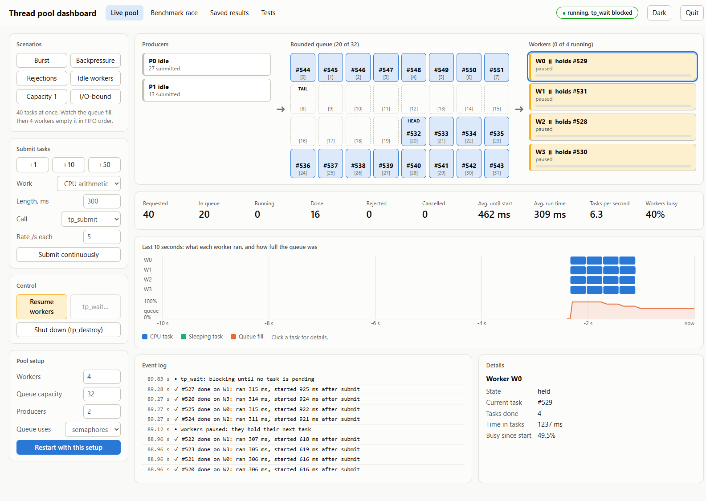

# Thread Pool and Producer-Consumer Library

A reusable thread-pool library in C11 with POSIX threads, built on a bounded
producer-consumer queue, and benchmarked against creating one thread per task.

| Deliverable | Where |
|---|---|
| Library | `include/`, `src/` (builds `build/libthreadpool.a`) |
| Unit tests | `tests/test.c` |
| Benchmark results | [docs/BENCHMARK.md](docs/BENCHMARK.md), raw data in `results/` |
| API documentation | [docs/API.md](docs/API.md) |
| Dashboard | `ui/`, start with `make ui` or `build/dashboard` |

| Course topic | Where it is used |
|---|---|
| Threads | workers in `src/threadpool.c` |
| Mutexes | queue state in `src/bqueue.c`, pending-task count in `src/threadpool.c` |
| Condition variables | `BQ_CONDVAR` queue backend, `tp_wait` |
| Semaphores | `BQ_SEMAPHORE` queue backend |

## Build and run

Linux or WSL with gcc and make:

    make            # library and all programs
    make test       # unit and stress tests
    make demo       # 8 tasks on 3 workers
    make ui         # dashboard in the browser
    make bench      # a few minutes, writes results/bench.csv
    make tsan       # tests under ThreadSanitizer
    make asan       # tests under AddressSanitizer + UBSan

Windows with MSYS2 (UCRT64 gcc): the same targets with `mingw32-make`, for
example `mingw32-make test`. The sanitizer targets need Linux.

Charts (optional): `pip install matplotlib`, then `python bench/plot.py`.

## Dashboard



Build once, then start `build/dashboard.exe` by double-clicking it (or `make ui`).
It opens a page in the browser. No terminal, no other software needed.

- **Live pool**: producers, queue slots and workers of a real pool, with buttons to
  submit tasks, pause, wait, shut down and restart, and ready-made scenarios. Click
  anything for details.
- **Benchmark race**: sequential, thread per task and pool, timed on the spot.
- **Saved results**: charts of `results/bench.csv`.
- **Tests**: runs the library tests (`build/test`).

Everything shown comes from the C library. The web server is also C
(`ui/dashboard.c`), runs on its own pool from this library, and accepts connections
from this computer only. **Quit** ends it; it also ends 3 minutes after the page is
closed. Keep the program in the `build` folder, since it reads files of the project.

## Use it in another program

```c
#include "threadpool.h"

void work(void *arg) { /* ... */ }

int main(void)
{
    threadpool *pool = tp_create(4, 64);
    for (int i = 0; i < 100; i++)
        tp_submit(pool, work, NULL);
    tp_wait(pool);
    tp_destroy(pool);
}
```

    gcc main.c -Iinclude build/libthreadpool.a -pthread

A complete version that returns results is in `examples/demo.c`.
