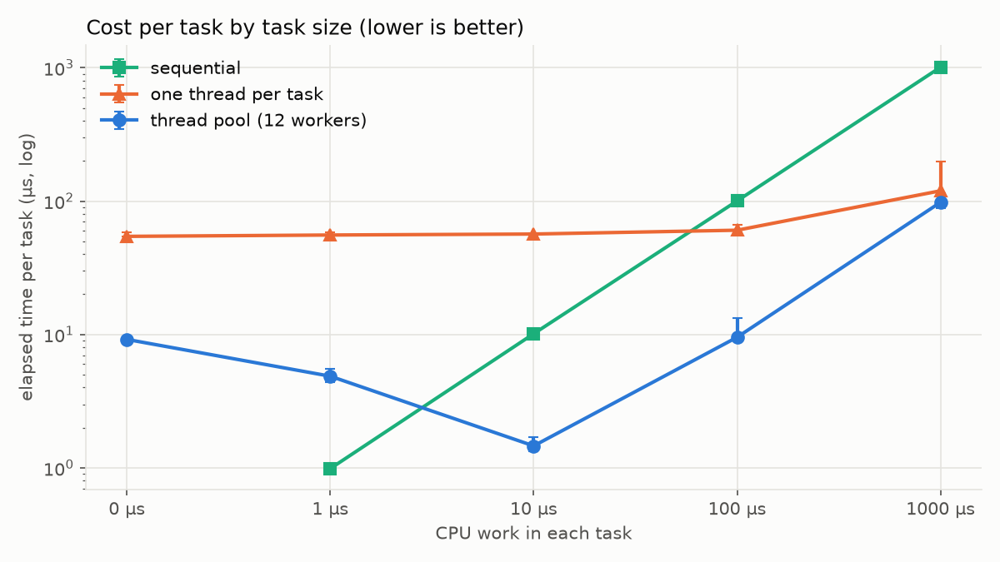
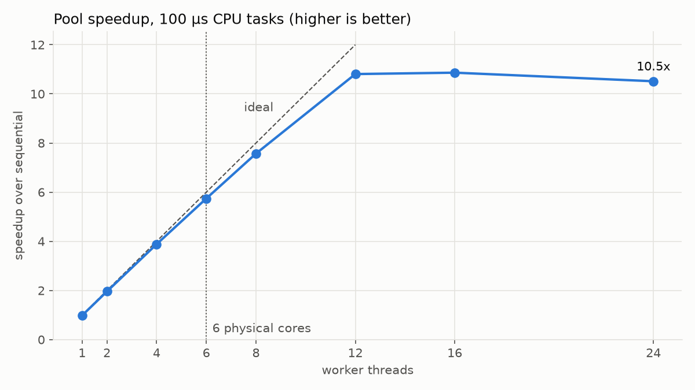
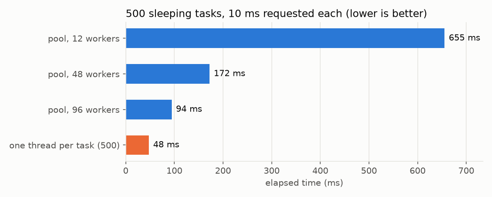
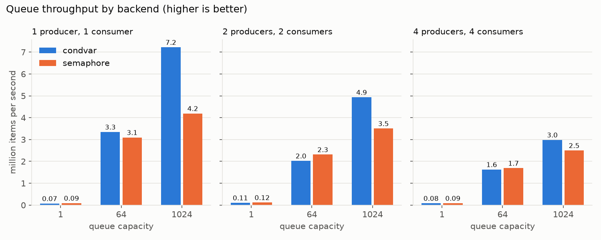

# Benchmark results

## Summary

- The pool beat one thread per task on CPU work at every task size: from 1.2x
  faster (1000 µs tasks) up to 39x (10 µs tasks).
- Creating and joining a thread cost about 54 µs. Tasks much shorter than that
  should never get their own thread.
- The pool is not always the best choice. Plain sequential code was faster for
  tasks of 1 µs or less, and one thread per task was faster for tasks that only
  sleep.
- Speedup grew to 10.8x at 12 workers (6 cores, 12 hardware threads). More
  workers did not help.

## Method

| | |
|---|---|
| CPU | Intel Core i7-8700, 6 cores / 12 hardware threads |
| OS | Windows 11 Pro |
| Compiler | gcc 15.2.0 (MSYS2 UCRT64), `-O2`, winpthreads |
| Clock | `CLOCK_MONOTONIC` |
| Repetitions | 5, after one discarded warm-up; tables show the median |
| Background CPU load | 6-16 % just before the run |

- **CPU tasks** run a fixed number of arithmetic operations, calibrated at
  startup (713 iterations per µs). They do not spin until a deadline, so tasks
  that compete for a core take longer, as real work would.
- **Thread per task** calls `pthread_create` for every task and then joins them
  all. The thread limit was never reached.
- **Pool** times include creating and destroying the pool. Queue capacity is 1024.
- Within a repetition the strategies run one after another, so slow drift in
  machine speed affects all of them.

Reproduce with `make bench` and `python bench/plot.py`. Raw data:
`results/bench.csv`. All medians, minimums and maximums: `results/summary.md`.

## 1. Task size

10,000 tasks (2,000 for 1000 µs). Pool of 12 workers. Times in ms.

| Work per task | Sequential | Thread per task | Pool | Pool vs thread per task | Pool vs sequential |
|--:|--:|--:|--:|--:|--:|
| 0 µs | 0.00 | 543.87 | 91.82 | 5.9x | slower |
| 1 µs | 9.88 | 556.64 | 48.65 | 11.4x | 0.2x (slower) |
| 10 µs | 101.34 | 566.15 | 14.62 | 38.7x | 6.9x |
| 100 µs | 1003.25 | 604.76 | 95.38 | 6.3x | 10.5x |
| 1000 µs | 2017.20 | 238.91 | 195.99 | 1.2x | 10.3x |

**Thread per task** stays near 55-60 µs per task until the tasks themselves are
longer. One thread creates all the others, so creation is the bottleneck: no
matter how many cores are free, they cannot be given work faster than that. At
1000 µs this matters much less, and the two strategies are close.

**The pool** pays for its threads once. Per task it pays only for passing the
task through the queue.

**Very small tasks are a bad fit for any threading.** At 0 and 1 µs, sequential
wins. The pool also took less time for 10 µs tasks than for empty ones. A likely
reason: with empty tasks the workers keep draining the queue and going back to
sleep, so many submits have to wake a thread, and all threads compete for the
same mutex. We did not measure this separately. Grouping several small items into
one task avoids the problem.

The sequential 0 µs time is below the resolution of the table and is left out of
the chart.

## 2. Pool size

10,000 tasks of 100 µs. Sequential time: 1001.98 ms.

| Workers | 1 | 2 | 4 | 6 | 8 | 12 | 16 | 24 |
|---|--:|--:|--:|--:|--:|--:|--:|--:|
| Time (ms) | 1021.12 | 511.77 | 258.03 | 174.53 | 132.38 | 92.72 | 92.24 | 95.30 |
| Speedup | 0.98x | 1.96x | 3.88x | 5.74x | 7.57x | 10.81x | 10.86x | 10.51x |

- One worker is 2 % slower than sequential: the overhead of the pool itself.
- Scaling is close to ideal up to the 6 physical cores and continues to 12. The
  second hardware thread of each core helps here because the test task is one long
  chain of dependent operations, which leaves parts of the core unused. Tasks
  that use the core more fully would gain less.
- Beyond 12 there is no hardware left to use. The differences between 12, 16 and
  24 are smaller than the spread between repetitions.

For CPU-bound work, use as many workers as hardware threads.

## 3. Sleeping tasks (simulated I/O)

500 tasks that each request a 10 ms sleep. Windows actually slept 15.3 ms on
average when measured alone.

| Strategy | Time (ms) |
|---|--:|
| Pool, 12 workers | 655.34 |
| Pool, 48 workers | 172.30 |
| Pool, 96 workers | 94.45 |
| One thread per task (500 threads) | **47.62** |

Here the pool loses. A sleeping task holds its worker without using the CPU, so a
pool of N workers needs `ceil(500 / N)` rounds. At 15.6 ms per round, Windows'
default timer interval, that predicts 655, 172 and 94 ms for 42, 11 and 6
rounds, which matches the measurements.

For blocking work, size the pool by how many tasks should be waiting at once, not
by the number of cores. The pool still limits resource use: it needed 96 threads
instead of 500.

## 4. Queue: condition variables vs semaphores

100,000 items of 8 bytes. Million items per second, higher is better.

| Capacity | Producers + consumers | Condvar | Semaphore |
|--:|--:|--:|--:|
| 1 | 1 + 1 | 0.07 | 0.09 |
| 1 | 2 + 2 | 0.11 | 0.12 |
| 1 | 4 + 4 | 0.08 | 0.09 |
| 64 | 1 + 1 | 3.35 | 3.10 |
| 64 | 2 + 2 | 2.02 | 2.31 |
| 64 | 4 + 4 | 1.63 | 1.69 |
| 1024 | 1 + 1 | 7.22 | 4.19 |
| 1024 | 2 + 2 | 4.93 | 3.50 |
| 1024 | 4 + 4 | 2.98 | 2.50 |

- **Capacity matters far more than the backend.** With one slot, producer and
  consumer must take turns, so nearly every item needs a thread switch. A larger
  buffer lets each side work for a while without sleeping.
- **Condvars win with a large buffer** (1.2x to 1.7x). Each semaphore operation
  adds synchronization on top of the mutex: two per push and two per pop.
- **With a small buffer the two are close**, and at capacity 1 the ranges
  overlap in every case (see `summary.md`), so no winner can be named there.
- Adding threads lowers throughput for both at capacities 64 and 1024, because
  every operation needs the same mutex.

The pool uses condition variables because its queue is normally large.

## Limits of these results

- One machine and one OS. Thread creation is usually cheaper on Linux, which would
  narrow the gap to the pool. We did not benchmark Linux.
- The CPU may change its clock speed with the number of active cores, so part of
  the missing speedup may come from the hardware.
- Sleeping only simulates I/O.
- Only elapsed time was measured, not memory or CPU use.
